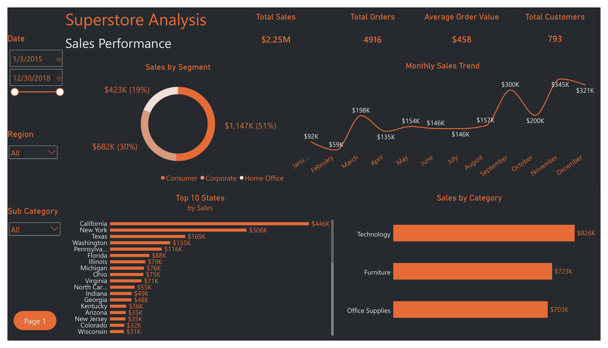
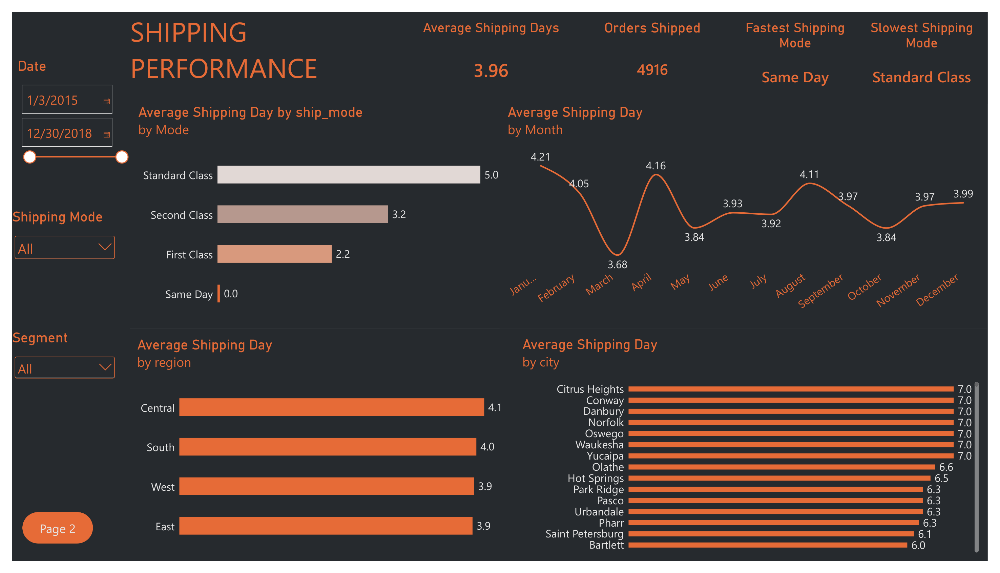
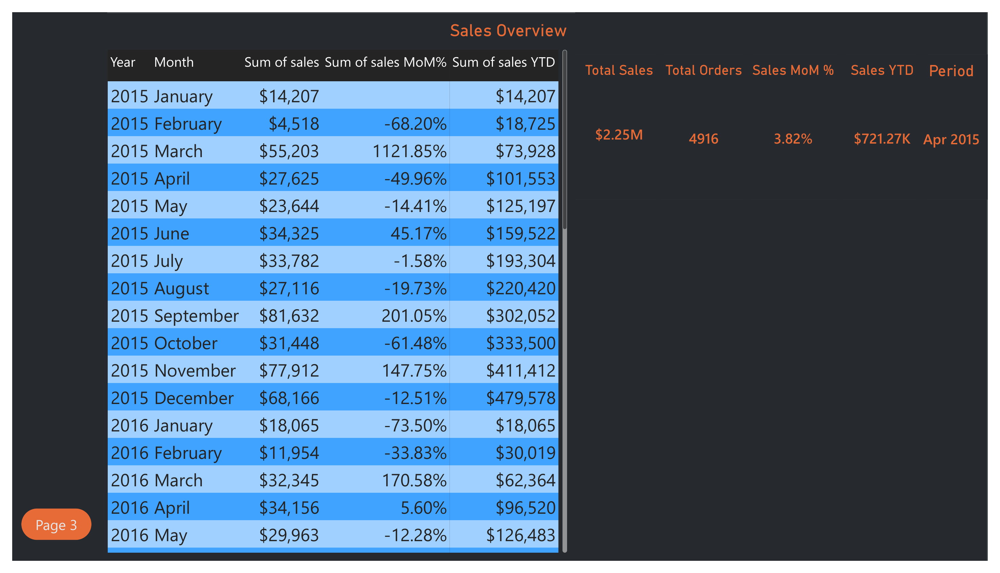
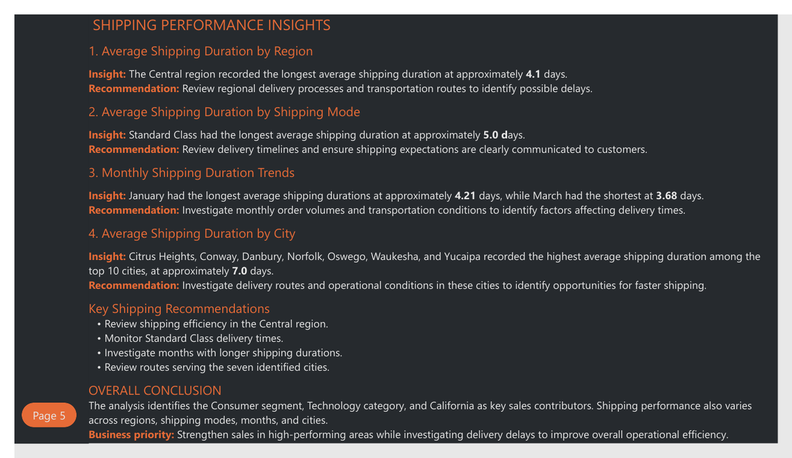

# Superstore Sales and Shipping Performance Analysis

## Project Overview

An end-to-end data analysis project exploring Superstore sales performance and shipping operations using Excel, MySQL, and Power BI.

The project focuses on identifying sales trends, understanding customer segments, evaluating product and regional performance, and analysing shipping efficiency to generate actionable business insights.

## Tools and Technologies
- **Excel:** Data cleaning and preparation.
- **MySQL:** Data querying, transformation, and analysis.
- **Power BI:** Interactive dashboards, data visualisation, and business insights.
- **DAX:** Calculated measures and performance metrics.

## Project Objectives
- Analyse overall sales performance and trends.
- Identify top-performing customer segments, products, and regions.
- Evaluate monthly sales performance using MoM and YTD metrics.
- Analyse shipping duration by shipping mode, region, month, and city.
- Develop business insights and recommendations.

## Dashboard Screenshots

### 1. Sales Performance

### 2. Shipping Performance

### 3. Sales Overview

### 4. Sales Insights and Recommendations

### 5. Shipping Insights and Recommendations

## Project Structure
- `Dashboard-Screenshots/` – Power BI dashboard images.
- `Documentation/` – Project documentation, business insights, and recommendations.
- `Power-BI-Dashboard/` – Power BI dashboard file.
- `SQL-Queries/` – SQL scripts used for data preparation and analysis.

## Key Learning Outcomes
- Data cleaning and preparation.
- SQL querying and data analysis.
- Dashboard development and visualisation.
- Business insight generation and analytical problem-solving.
