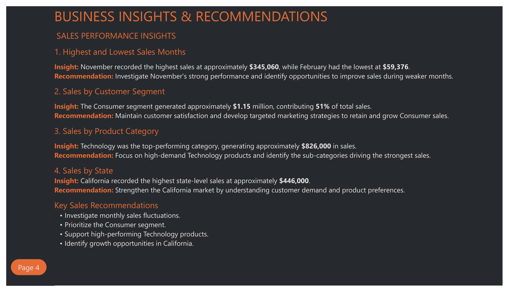

# Superstore Sales & Shipping Performance Analysis

## Project Overview

This project analyses Superstore sales and shipping performance to identify revenue trends, understand product and regional sales contributions, and evaluate shipping efficiency.

The analysis uses Excel, SQL (MySQL), and Power BI to clean, prepare, analyse, and visualise the dataset, translating business data into actionable insights and recommendations.

## Data Source

The dataset used for this project was obtained from Kaggle.

**Dataset:** [Superstore Sales Dataset – Kaggle](https://www.kaggle.com/datasets/bhanupratapbiswas/superstore-sales)

The dataset contains sales, customer, product, order date, shipping date, and geographical information used to analyse sales performance and shipping efficiency.

The dataset was prepared and analysed using Excel, MySQL, and Power BI.

## Project Objectives

- Analyse overall sales and order performance.
- Identify monthly sales trends and growth patterns.
- Evaluate sales performance across customer segments and product categories.
- Identify top-performing states and regions.
- Analyse shipping duration across different shipping modes.
- Develop business insights and recommendations.

## Tools & Technologies

| Tool | Purpose |
|---|---|
| Excel | Data review and column organisation |
| SQL (MySQL) | Data querying, cleaning, date conversion, calculations and preparation using MySQL|
| Power BI | Data visualisation and interactive dashboards |
| DAX | Measures and performance calculations |
| GitHub | Project documentation and portfolio presentation |

## Project Workflow

The project followed four main stages:

1. **Excel – Dataset Organization:** Rearranged the dataset columns to improve data organization and readability.
2. **MySQL – Data Cleaning and Preparation:** Converted order and shipping dates into DATE data types using `STR_TO_DATE()`, calculated shipping duration using `DATEDIFF()`, and added customer order counts using a CTE and `LEFT JOIN`.
3. **Power BI – Data Analysis and Visualization:** Imported the cleaned dataset, developed DAX measures, analysed sales and shipping performance, and created interactive dashboards.
4. **Business Insights and Recommendations:** Identified key sales trends, evaluated shipping efficiency, and developed actionable recommendations to support business decision-making.

## Project Structure

| Folder | Contents |
|---|---|
| `Dashboard-Screenshots/` | Dashboard screenshots |
| `Documentation/` | Project documentation, insights and recommendations |
| `Power-BI-Dashboard/` | Power BI dashboard file (.pbix) |
| `SQL-Queries/` | SQL scripts used for data preparation |

## Key Performance Indicators

- Total Sales: $2.25M
- Total Orders: 4,916
- Total Customers: 793
- Average Order Value: $458
- Average Shipping Duration: 3.96 days

## Dashboard Pages

1. **Sales Performance:** Overall sales, customer segments, product categories, state performance and monthly sales trends.

2. **Shipping Performance:** Shipping duration, shipping modes and shipping performance analysis.

3. **Sales Overview:** Monthly sales revenue, month-over-month growth and year-to-date performance.

4. **Sales Insights and Recommendations:** Key sales findings and recommendations.

5. **Shipping Insights and Recommendations:** Key shipping findings and recommendations.

## Key Business Findings

- Technology recorded the highest category sales at approximately $826K.
- California recorded the highest state sales at approximately $446K.
- November recorded the highest total monthly sales, contributing approximately $345K across the years analysed.
- Same Day was the fastest shipping mode, while Standard Class recorded the longest average shipping duration.

## Project Documentation

Detailed project documentation is available in the [Documentation folder](Documentation/).

- [Project Overview](Documentation/01-Project-Overview.md)
- [Data Preparation](Documentation/02-Data-Preparation.md)
- [Sales Performance](Documentation/03-Sales-Performance.md)
- [Shipping Performance](Documentation/04-Shipping-Performance.md)
- [Business Insights and Recommendations](Documentation/05-Business-Insights-and-Recommendations.md)

## SQL Queries

The SQL scripts used for data cleaning and preparation are available in the [SQL-Queries folder](SQL-Queries/).

## Power BI Dashboard

The Power BI dashboard file (.pbix) is available in the [Power-BI-Dashboard folder](Power-BI-Dashboard/).

Download the `.pbix` file from this folder and open it using **Power BI Desktop** to explore the interactive report and its visualisations.

## Project Limitations

The dataset does not contain profit or cost information. Therefore, the analysis focuses on sales revenue and shipping performance rather than profitability.

Shipping duration represents the time between order date and ship date, not the final delivery date.

## Conclusion

This project demonstrates practical data analysis skills using Excel, SQL (MySQL), Power BI, and DAX. It highlights the process of transforming raw business data into meaningful insights that support informed decision-making.

## Dashboard Screenshots

### 1. Sales Performance

### 2. Shipping Performance

### 3. Sales Overview

### 4. Sales Insights and Recommendations

### 5. Shipping Insights and Recommendations

## Key Learning Outcomes

- Data cleaning and preparation.
- SQL querying and data analysis.
- Dashboard development and visualisation.
- Business insight generation and analytical problem-solving.

  
